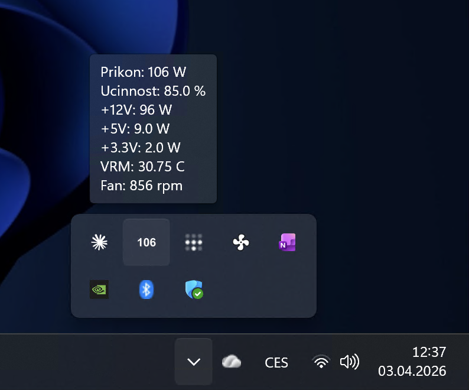

# rm1000i-tray

Windows system tray widget that shows the live power output of a Corsair RM1000i power supply. iCUE does not expose this number.


[](https://github.com/koprjaa/rm1000i-tray/actions/workflows/ci.yml)



The widget reads the PSU over USB HID every second. Its icon turns red above 800 W. The tooltip shows total output power, estimated efficiency, power on all three rails, VRM temperature, and fan speed, limited to 127 characters.

## Install

Install stable Rust with its Windows build tools, then run:

```powershell
cargo install --path .
rm1000i-tray
```

For automatic startup at login, run this from the project directory:

```powershell
powershell -ExecutionPolicy Bypass -File install.ps1
```

The script runs `cargo build --release`, registers the quoted executable path in the current user's registry Run key, and starts it. Keep `target/release/rm1000i-tray.exe` at that location. To uninstall autostart, remove the `RM1000iTray` value from `HKCU:\SOFTWARE\Microsoft\Windows\CurrentVersion\Run`.

Close iCUE before starting the widget: competing HID clients can prevent access or corrupt responses.

## Use

```powershell
rm1000i-tray
rm1000i-tray --once
```

Tray mode waits 10 seconds before registering its loading icon. Right-click the icon and select **Quit** to exit. Release builds have no console window.

`--once` skips the tray and startup delay, prints every supported metric as `key: value unit`, and exits. It returns 1 if no RM1000i is available or reading fails, and 2 for invalid arguments. On Windows, use PowerShell's `Start-Process -Wait` if the shell does not wait for a GUI executable; stdout can also be redirected for comparison with `liquidctl status`.

## Hardware and safety

Discovery selects the first USB device with Corsair VID `0x1b1c` and RM1000i PID `0x1c0d`. Other RMi/HXi models are not selected. The original widget's `RM1000i` match also restricted actual discovery despite the broader hardware list in its documentation.

The protocol is implemented directly using `hidapi`. The only outgoing commands are reads of input voltage, rail voltage/current/power, temperatures, fan speed, total output power, and PAGE selection (0–2). An assertion checks an explicit whitelist before each write. No OCP, fan, configuration, or initialization commands are sent.

The [liquidctl Corsair driver](https://github.com/liquidctl/liquidctl/blob/main/liquidctl/driver/corsair_hid_psu.py) and [PMBus decoder](https://github.com/liquidctl/liquidctl/blob/main/liquidctl/pmbus.py) were used as protocol references. Connecting only opens a HID handle. Its separate `initialize` method sends a `fe 03` handshake, writes OCP mode, and restores hardware fan control. This app omits that entire sequence, as did the original widget. A freshly booted or resumed PSU may therefore reject reads until initialized outside this app. Invalid/uninitialized replies cause a reconnect, never an automatic configuration change.

Estimated input power uses liquidctl's RM1000i quadratic curves at 115/230 V, interpolates by measured input voltage, and rounds to the nearest even integer. Estimated efficiency is output divided by that rounded estimate, rounded again. These are estimates, not measured AC input power.

## How it works

A failed read drops the handle and retries discovery on the next tick. The icon and tooltip keep the last complete reading. Each HID response has a one-second timeout; the one-second polling interval follows each read attempt, so slow or failed reads can lengthen the update period. Shutdown does not wait for the polling worker.

Icons are 256×256 RGBA, transparent, with centered Arial Bold from `C:/Windows/Fonts/arialbd.ttf`, at em size 155 for at most three characters and 120 otherwise. A bundled DejaVu Sans Bold font is used if Arial cannot be loaded; its license is in `assets/FONT-LICENSE`.

## Changes from the Python version

- Every reply is checked against the request. When another tool (FanControl, iCUE) polls the PSU at the same time, replies meant for it are skipped instead of being shown as readings. liquidctl does not check this, so the Python widget could briefly display a value read from someone else's request.
- A compiled Rust executable replaces the interpreter and runtime packages. Release tray mode needs no console; debug builds retain one. Installation and registry autostart point directly to the executable rather than a PowerShell/Python launcher.
- Added `--once`, `--help`/`-h`, explicit argument validation and exit codes. On Linux only diagnostics are available; tray mode reports an error immediately.
- Direct HID replaces liquidctl; Linux diagnostics use HID rather than liquidctl's optional hwmon path, and may require device permissions or release of the kernel driver. Only the original RM1000i hardware match is implemented, using exact USB IDs instead of a description substring.
- Status contains 16 numeric metrics. It omits liquidctl's current/total uptime, fan control mode, and OCP mode because the widget never displayed them. Voltage/current on all rails, case temperature, input voltage, and estimated input power are available through `--once`.
- Status values have one numeric representation (`f64`); integral readings display a `.0`, including fan RPM. Python preserved the integer/float type supplied by its driver (the original integer fake fan fixture displayed `880`, while direct liquidctl readings display `880.0`). Rust's decimal/scientific notation can also differ for very small values. Non-finite wattage is shown as `??` rather than failing integer conversion.
- Font rasterization uses `ab_glyph`, so antialiasing and pixel bounds can differ slightly from Pillow. The fallback is bundled DejaVu Sans Bold at the requested size instead of Pillow's small default font.
- HID transactions reject short writes, short reports, mismatched echoes and timeouts. Queue draining is bounded to 65 reads. Read/connection failures still preserve the previous display and reconnect. The app does not initialize hardware or change configuration, matching the original widget's omission of `initialize`.
- Menu events are checked at most 100 ms apart. USB work runs on a background thread and display updates run on the Windows event loop. The visible name of the executable and its tray implementation change; the loading label, tooltip fields, thresholds, startup delay and polling interval remain the same.

## Development

```sh
cargo build --release
cargo test
cargo clippy --all-targets -- -D warnings
cargo fmt --check
cargo check --target x86_64-pc-windows-gnu
```

The last command on Linux needs `rustup target add x86_64-pc-windows-gnu` and a MinGW GCC toolchain. CI checks Linux and Windows. Tests cover the original formatting, icon and reconnect scenarios, LINEAR11 signed decoding, efficiency estimates, exhaustive opcode whitelist checks, mocked HID failures and the CLI. No PSU is needed; real hardware readings and the Windows tray still require manual validation.

Dependencies: `hidapi` provides USB access (the Linux basic-udev backend avoids a system libudev build dependency); `image` stores RGBA pixels without codec features; `ab_glyph` rasterizes TrueType fonts. Windows additionally uses `tray-icon` for the tray/menu, `winit` for its event loop, and `windows-sys` to attach diagnostic output to the invoking console. CLI tests use only the standard library.

## License

[MIT](LICENSE). The bundled fallback font retains its own license.
